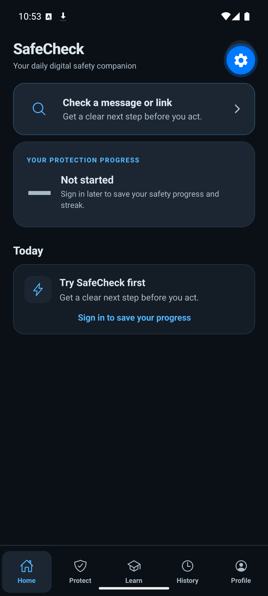
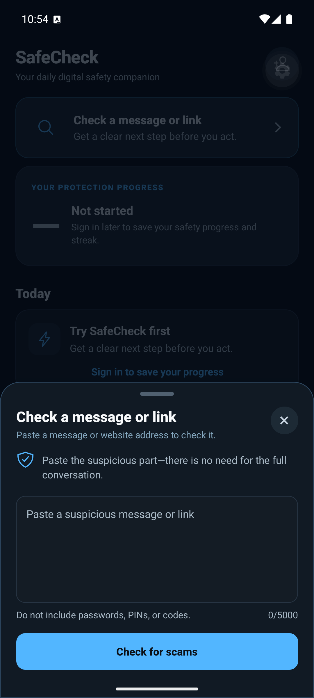
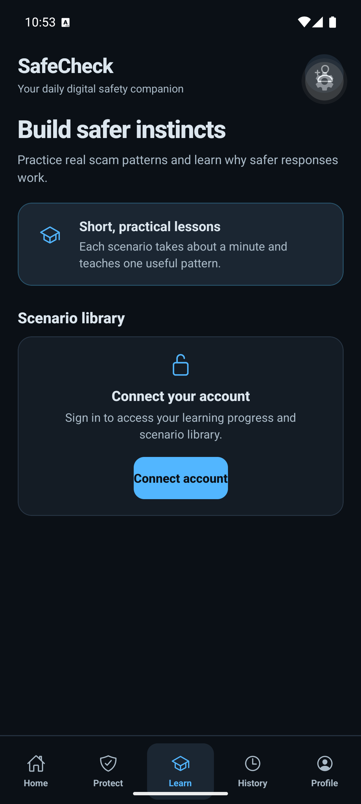
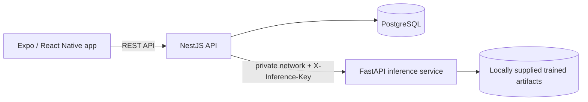

# SafeCheck


SafeCheck is a mobile safety companion for spotting suspicious messages, links, and job offers. It combines practical checks with interactive learning scenarios, so people can both assess a questionable message and learn what warning signs to look for next time.

> **Model files are not included.** The trained inference artifacts are intentionally excluded from this repository. The inference service needs an authorized model bundle to start; see [safecheck-inference/models/README.md](safecheck-inference/models/README.md).

## What it does

- Check suspicious messages and links and get a risk level, score, warning signs, and a recommended next step.
- Learn through interactive scam-awareness scenarios and daily challenges.
- Review scan history, progress, and safety tips.
- Create an account and securely manage a session; email verification depends on API mail configuration.
- Share text or a web link from another app into SafeCheck on supported Android and iOS builds.
- Use live group learning sessions and optional Premium billing when those API features are configured.

## Screenshots and demo

| Home | Message/link checker | Learn |
| --- | --- | --- |
|  |  |  |

[Watch the Android walkthrough](docs/safecheck-demo.mp4) · [Onboarding screenshot](docs/screenshots/android-onboarding.png)

These are real captures from an Android development build. The demo shows the client UI; the API and private inference model were not running during the recording, so live scans and account-backed features are not demonstrated.

## Architecture



The mobile app communicates with the API only. The API handles accounts, scan persistence, limits, and product features; it is the only service that calls inference. Keep the inference service private and do not expose model files to mobile clients.

## Repository layout

| Path | Contents |
| --- | --- |
| [`app/`](app/) | Expo SDK 57 / React Native mobile application |
| [`backend/`](backend/) | NestJS API, Prisma schema and migrations, authentication, safety and product endpoints |
| [`safecheck-inference/`](safecheck-inference/) | FastAPI inference service and its tests |
| [`docker-compose.yml`](docker-compose.yml) | Local PostgreSQL, inference, and API services |

## Requirements

- Node.js 22 and npm
- Docker Desktop with Docker Compose v2 for the full backend stack
- An Android device/emulator or iOS simulator/device for the mobile app (iOS builds require macOS)
- Python 3.12 if running inference or its tests outside Docker
- The trained model bundle, acquired and supplied separately; see [the model setup notes](safecheck-inference/models/README.md)

## Run the full stack locally

### 1. Configure secrets

Create a root `.env` file:

```dotenv
POSTGRES_DB=safecheck
POSTGRES_USER=safecheck
POSTGRES_PASSWORD=replace-with-a-long-random-password
INFERENCE_API_KEY=replace-with-a-separate-long-random-secret
USE_CUDA=0
```

Create `backend/.env` with at least:

```dotenv
JWT_ACCESS_SECRET=replace-with-a-long-random-secret
JWT_REFRESH_SECRET=replace-with-a-different-long-random-secret
```

Do not reuse the database password, JWT secrets, or inference key. SMTP settings (`SMTP_HOST`, `SMTP_PORT`, `SMTP_USER`, `SMTP_PASSWORD`, `SMTP_FROM`) are needed for email delivery. Paystack settings are needed only if enabling Premium checkout and webhooks. Never commit either `.env` file.

### 2. Supply model artifacts

Place the approved model bundle in `safecheck-inference/models/`. The inference process expects `primary_deberta/`, `behavior_deberta/`, `character_expert.joblib`, `ensemble_meta_calibrator.joblib`, `ensemble_meta_feature_names.json`, `model_contract.json`, and the configured decision policy in that directory. Consult the private bundle's documentation for the exact artifact versions and provenance. The files are ignored by Git.

### 3. Start services and migrate the database

From the repository root:

```sh
docker compose up --build -d postgres inference
docker compose run --rm api npx prisma migrate deploy
docker compose up -d api
docker compose ps
```

The API is available at `http://localhost:3000/api/v1`; its health endpoint is `http://localhost:3000/api/v1/health`. The inference service is intentionally not published to the host. Docker Compose passes `INFERENCE_API_KEY` to both services and waits for PostgreSQL and inference readiness.

To stop the stack:

```sh
docker compose down
```

Add `-v` only when you intentionally want to delete the local PostgreSQL data volume.

## Run the mobile app

Set the API URL in the shell before starting Expo. For an Android emulator, `10.0.2.2` normally routes to the host machine; for a physical device, use the host's LAN IP address:

```powershell
$env:EXPO_PUBLIC_API_URL = "http://10.0.2.2:3000/api/v1"
npm ci --prefix app
npm run start --prefix app
```

Use the Expo development build for this app's native integrations. With an Android emulator/device connected and Android SDK configured, build and launch it with:

```powershell
$env:EXPO_PUBLIC_API_URL = "http://10.0.2.2:3000/api/v1"
npm run android --prefix app
```

For a physical Android device, use `http://<computer-lan-ip>:3000/api/v1` instead and allow the device to reach port 3000. iOS native builds must be built on macOS. API features such as registration, scanning, and saved history require the backend and database to be running.

## Run tests and builds

```sh
npm run build --prefix backend
npm test --prefix backend -- --runInBand
python -m pytest safecheck-inference/tests
npx tsc --noEmit --project app/tsconfig.json
```

The Python tests require the inference service dependencies from `safecheck-inference/requirements.txt`. Tests that initialize the inference engine also require the private model bundle.

## Configuration and deployment notes

- Set `EXPO_PUBLIC_API_URL` to the public HTTPS API base ending in `/api/v1` for a release build.
- Use managed PostgreSQL with backups, TLS, and a least-privilege database account.
- Keep inference on a private network, configure `INFERENCE_API_KEY`, and leave `ALLOW_RULE_FALLBACK` disabled in production.
- Run `prisma migrate deploy` as a release step before routing API traffic.
- Set `CORS_ORIGIN` to the exact allowed web origin(s), if applicable.
- Configure and monitor API/inference readiness, latency, failures, and database availability.
- Store all production credentials in a secrets manager. Do not put secrets in app configuration or source control.

## License

See [LICENSE](LICENSE).
